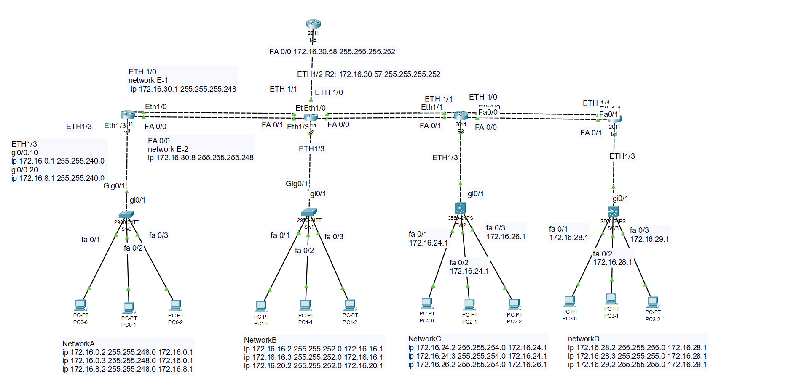

# enterprise-network-lab — 멀티 사이트 엔터프라이즈 네트워크 구축

> **Multi-site enterprise network in Cisco Packet Tracer** — VLSM addressing, OSPF multi-area (Area 0–4) with dual backbone links and cost-based failover, VLAN separation with *both* Router-on-a-Stick and SVI, inter-VLAN ACL, and static + dynamic split routing. Every feature is verified (ping matrix, ACL before/after with match counts, link-failure test, packet captures) and every problem hit along the way is written down. Report in Korean: [`docs/report.md`](docs/report.md).

 미니 프로젝트 · 개인 작업 · 이현정 · 2026-07-05 · Cisco Packet Tracer

## 무엇을 했나

과제 요구사항은 **VLSM 서브네팅 + 이중 링크 + 모든 PC 간 통신**이었다. 그 위에 아래를 더 설계하고 각각 검증했다.

| 항목 | 구현 | 검증 |
|---|---|---|
| VLSM | 172.16.0.0/16 에서 A 4,000 · B 2,000 · C 1,000 · D 500 · 백본 6×6 IP, 큰 대역부터 경계 정렬 | 주소표 (보고서 2.3) |
| OSPF 멀티에어리어 | 백본 = Area 0, 사이트 = Area 1~4, R1~R4 가 ABR | `show ip route` 에 타 사이트가 `O IA` 로 표시 |
| 이중 링크 · 장애 우회 | 구간마다 링크 2개, Cost 10(주) / 100(부) | 주 링크 shutdown → 이웃 2→1, 경로 E-1→E-2 자동 전환, ping 4개 중 1개 손실(재수렴), 복구 후 주 경로 복귀 |
| Inter-VLAN 두 방식 | 사이트 A·B = Router-on-a-Stick(2960 + 서브인터페이스), C·D = SVI(3560 `ip routing`) | 같은 토폴로지에서 홉 수 차이를 캡처로 비교 |
| ACL | 사원(VLAN10)은 타 사이트 관리자(VLAN20) 접근 차단, 관리자↔관리자 · 사원↔사원은 허용 | 적용 전/후 ping, `show access-lists` match count 증가, 차단 응답이 ICMP Type 3 / Code 13 |
| 분할 라우팅 | 내부 = OSPF, 인터넷 경계(R2–R5) = 정적 디폴트 + `default-information originate` 로 재배포 | R1 에서 디폴트 라우트 학습, R5 Loopback(8.8.8.8) 도달 |
| 패킷 분석 | Simulation Mode 캡처 | 홉마다 MAC 바뀌고 IP 유지 · TTL 255→254→253 · 트렁크에서만 802.1Q 태그(TCI 0x00a) · OSPF Hello(Area 0, 10/40) |

## 막힌 것과 푼 방법

| 문제 | 원인 | 해결 |
|---|---|---|
| HWIC-4ESW 모듈 포트에 IP 를 줄 수 없음 | 라우팅 모듈이 아니라 스위칭 칩(L2) 모듈 | 2811 + NM-4E(라우팅 전용)로 교체 |
| 케이블 목록에 인터페이스 이름 중복 | 모듈을 여러 번 뗐다 붙여 Packet Tracer 캐시가 남음 | CLI(`show ip interface brief`) 기준으로 재확인, 라우터 재생성 |
| 2960 에서 `ip routing` 불가 | L2 전용 스위치 | SVI 사이트(C, D)는 3560(L3)으로 |
| Protocol Down 이 계속됨 | 반대편 설정 전 (정상적인 중간 상태) | 양쪽 설정 후 재확인 |
| 디폴트 라우트가 안 퍼짐 | `default-information originate` 후 OSPF 미반영 | `clear ip ospf process` 로 재수렴 |
| R5 와 통신 두절 | IP 오타 (172.16 → 172.26) | 재입력 |
| R5 까지는 가는데 응답이 없음 | R5 에 내부망으로 **돌아오는** 경로 없음 | R5 에 172.16.0.0/16 정적 라우트 |

마지막 줄이 가장 자주 만나는 함정이다 — 가는 길만 있고 돌아오는 길이 없으면 "연결은 되는데 응답이 없다".

## 장비

| 역할 | 모델 | 이유 |
|---|---|---|
| R1 · R4 (체인 끝) | Cisco 2811 | 인터페이스 3개면 충분 |
| R2 · R3 (체인 중간) | 2811 + NM-4E | 사이트 1 + 이중 링크 양쪽 4 = 5개 필요, 라우팅 포트 모듈 |
| SW0 · SW1 | Catalyst 2960 (L2) | Router-on-a-Stick 이라 라우팅 불필요 |
| SW2 · SW3 | Catalyst 3560 (L3) | SVI · `ip routing` 필요 |
| R5 | 2811 | 인터넷 대신 (Loopback 8.8.8.8) |

## 파일

| 경로 | 내용 |
|---|---|
| [`docs/report.md`](docs/report.md) | 전체 보고서 (설계 · 설정 화면 · 검증 · 캡처 · 트러블슈팅), 그림 47장 |
| `docs/img/` | 토폴로지 · CLI · 검증 · 캡처 화면 |
| `docs/original/report.docx` | 원본 보고서 |

## 한계

- **Packet Tracer 시뮬레이터**다. 실제 IOS 와 다른 점이 있다 (모듈 인식 · 일부 CLI). 캡처는 Wireshark 가 아니라 Packet Tracer Simulation Mode 의 PDU 화면이다.
- Packet Tracer 파일(`.pkt`)과 장비 설정 원문(`show running-config`)은 아직 올리지 않았다 — 설정은 보고서의 CLI 화면으로만 볼 수 있다.
- 토폴로지 그림의 일부 라벨은 VLAN 을 나누기 전 값이다 (예: R1 서브인터페이스 `255.255.240.0`). 실제 적용한 값은 보고서 2.3.2 의 VLAN 별 주소표(/21 등)다.
